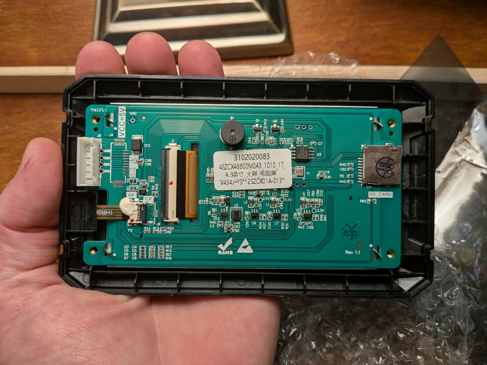
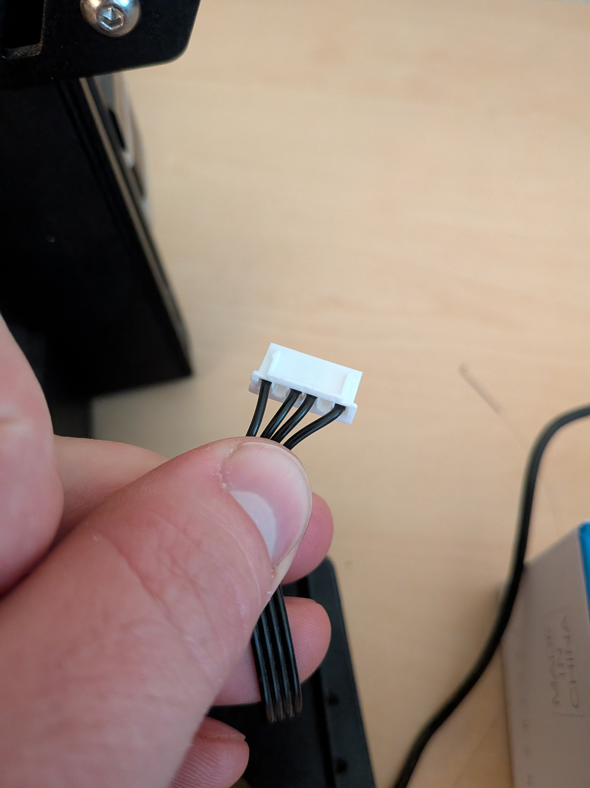

# Hardware and connector reference

## Identify the parts rather than copying a generic Ender diagram

This installation uses an Ender 3 S1 Plus with an STM32F401 mainboard, a Raspberry Pi 3B and an original DACAI touchscreen. The board's USART2 uses PA3 for receive and PA2 for transmit. Check your own MCU and board revision. Other Creality models can put different UARTs on their screen connectors.

The photographs below are the actual owner's hardware. EXIF/XMP metadata was removed for publication; compressed image pixels were not recompressed or annotated.

The PCB connector labels read GND, DOUT, DOUT, DIN, DIN, VCC. The cable has four populated positions. A photograph of all-black wires does not identify ground by itself; the keyed mating orientation and continuity matter. The two photographs of opposite PCB sides must not be interpreted as arbitrary loose-plug left/right pinouts.

## Verified screen-cable mapping

| Screen-labelled cable contact | Pi physical pin | BCM function |
|---|---:|---|
| GND | 6 | Ground |
| TX / DOUT | 8 | GPIO14 TXD0 |
| RX / DIN | 10 | GPIO15 RXD0 |

The Pi is replacing the screen. Thus screen TX to Pi TX and screen RX to Pi RX is correct for this identified cable. Seen from the mainboard instead, this is the conventional printer TX to Pi RX and printer RX to Pi TX.

Power VCC is separate. It was initially omitted for UART testing; the owner later used the display 5V contact to supply Pi physical pin 4, with micro-USB power disconnected. That powers the Pi but caused voltage warnings with the USB webcam. It is not a validated recommendation for other installations.

## Alternate mainboard header

Upstream's pinned S1 Plus configuration identifies the 2x5 LCD header as pin 3 TX, 4 RX, 9 GND, 10 VCC. On that header, TX goes to Pi physical 10 and RX to Pi physical 8. This numbering is not the six-position DACAI connector numbering. Do not use the header VCC until its voltage and intended use are confirmed.

## Pi header orientation and logic

Use physical positions 8 and 10, rather than GPIO numbers 8 and 10. Ground here is physical 6. Physical pin 4 is the 5V supply rail; it is not a 3.3V GPIO signal.

The serial signalling is 3.3V logic. Pi inputs must not receive 5V. A running UART connection is evidence of communication, not a measurement of signal amplitude. The owner's cable signal voltage has not been measured with a meter or oscilloscope.

Keep signal wires short and mechanically secure. Replace temporary jumper contacts with a suitable harness before relying on the assembly long term. Any planned increase in power through the same cable needs separate conductor and contact-current validation.

## Ports for the future screen and camera

The ordered BIGTREETECH Pi TFT43 is intended for KlipperScreen on the Pi. Confirm the actual revision and its DSI connection from the manufacturer's files before installation; do not confuse it with a similarly named serial Marlin TFT43. A CSI Pi camera would use the camera connector, a separate connector from the display port. Neither is installed or validated as part of the present UART result.

Sources: [pinned Klipper board configuration](https://github.com/Klipper3d/klipper/blob/9cb99754c035b90206ef0a02660f674fc9517e9b/config/printer-creality-ender3-s1plus-2022.cfg), [Pi UART documentation](https://www.raspberrypi.com/documentation/computers/configuration.html#configuring-uarts), [BIGTREETECH hardware](https://github.com/bigtreetech/BIGTREETECH-TouchScreenHardware).
