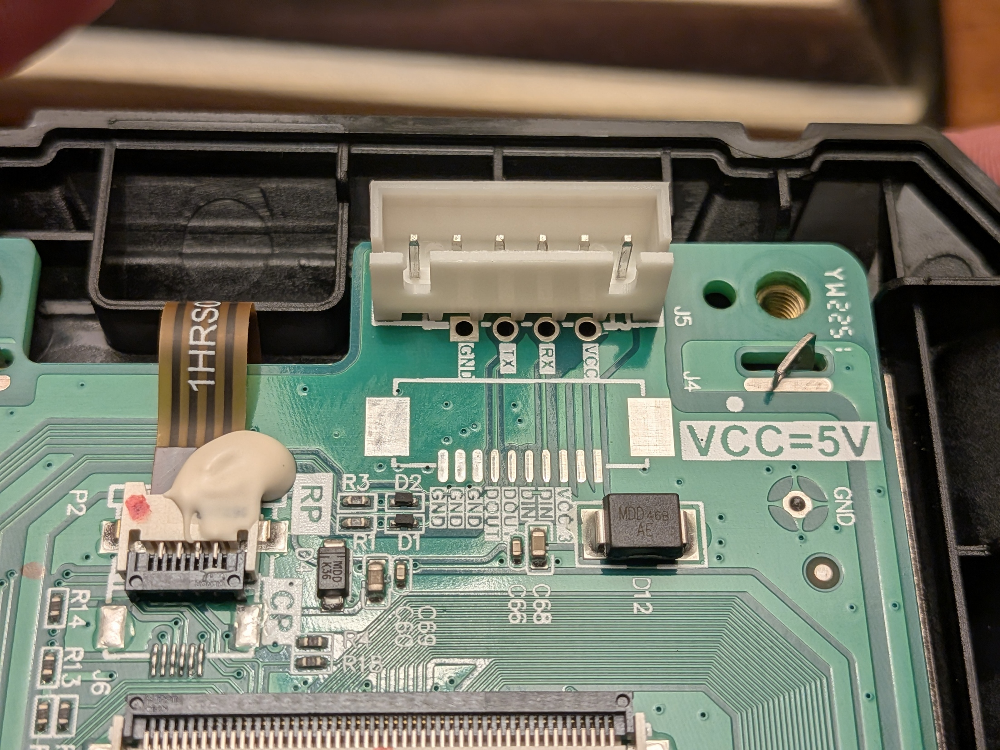
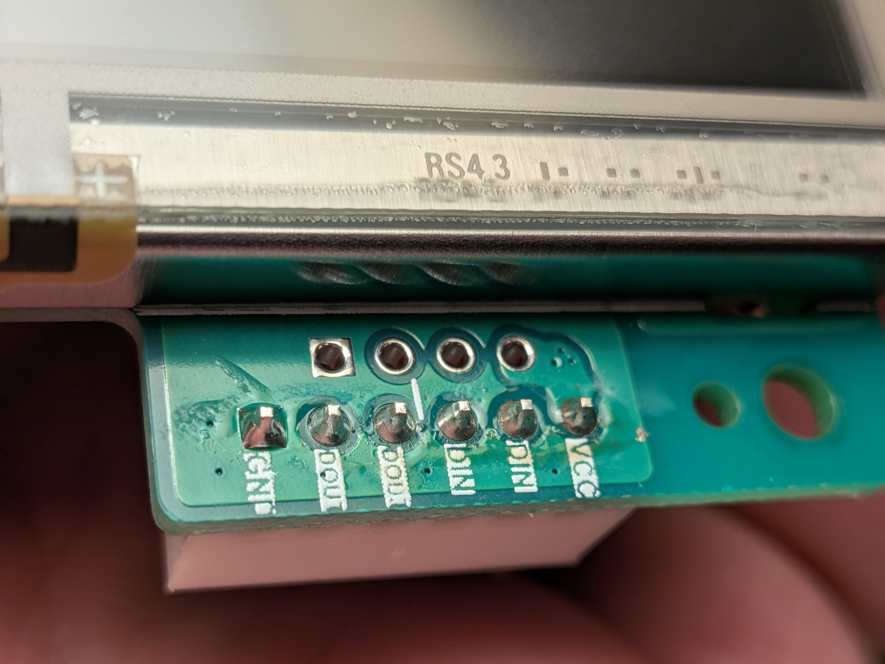

# Ender 3 S1 Plus: Klipper over the stock display cable

A working, documented conversion from unreliable USB communication to direct UART between a **Raspberry Pi 3B** and the **stock STM32F401 Ender 3 S1 Plus mainboard**, reusing the cable formerly connected to the **DACAI touchscreen**.

**Current result, 18 October 2026:** communication over the screen UART connector has been flawless in the owner's use since conversion, including **two explicitly reported successful prints**. A read-only check also confirmed another print underway over UART while this repository was prepared. This is one machine's experience, not a guarantee for every board revision.

**Work in progress:** an internal buck converter, a BIGTREETECH Pi TFT43 running KlipperScreen, and an enclosure using the original screen mounting points. A webcam mount is being printed. These upgrades are planned, not installed and validated.

## What works, and what still needs work

| Area | Current state |
|---|---|
| Printer connection | Working: USART2, printer PA3 RX / PA2 TX, Pi PL011 UART, 250000 baud |
| Physical connection | Original display cable, DACAI screen disconnected |
| Host configuration | `/dev/serial0`, resolving to `/dev/ttyAMA0` on this Pi |
| MCU firmware | Klipper `v0.13.0-800-g9cb99754c`; live identity confirms PA3/PA2 |
| Printing | Owner reports two successful prints; UART remains the working baseline |
| Pi power | Currently taken from stock display-cable 5V into Pi physical pin 4; **power margin is unresolved** |
| Webcam | USB device identified itself as NexiGo N60 FHD; unplugging stopped frequent undervoltage events during the observed comparison |
| Better internal power | Buck converter ordered; installation and measurements pending |
| New touchscreen | BIGTREETECH Pi TFT43 ordered; revision to confirm on arrival; KlipperScreen pending |
| Enclosure | Planned Pi + screen enclosure on the original mounting points; CAD/STL not yet available |
| Webcam mount | Printing; no completed/tested mount file is published here yet |

The goal is one existing printer mains lead, reliable UART, and a tidy local touchscreen. No extra external Pi power brick is planned.

## Read before connecting anything

- **Check the MCU marking.** This build is for **STM32F401**, not the F103 variant. It uses a **64 KiB bootloader** and an **8 MHz reference clock**. Do not flash it to a different MCU or board on the strength of the printer name alone.
- **Pi TX/RX are 3.3V logic.** The cable's 5V supply contact is a separate power signal. Never connect 5V to Pi TX/RX or a 3.3V pin.
- Shut the Pi down and remove power from both devices before changing wires. With the present power arrangement, switching off the printer also removes Pi power.
- Begin with **TX, RX and ground only, and an adequate independent Pi supply** if you are reproducing just the communication conversion. Display-cable power on this machine produced undervoltage; it is documented as an observation, not a validated power design.
- The full printer configuration is a **machine-specific snapshot**. Probe geometry, Z offset, mesh, PID, extruder calibration, shaping and travel limits must be checked on your own printer before motion or heating.

## Hardware and software used

- Creality Ender 3 S1 Plus, stock STM32F401 mainboard.
- Stock DACAI touchscreen and its four-conductor cable in a six-position plug. The screen is disconnected in the working UART setup.
- Raspberry Pi 3 Model B Rev 1.2, 64-bit MainsailOS / Debian 13 (Trixie).
- Klipper source revision [`9cb99754c035b90206ef0a02660f674fc9517e9b`](https://github.com/Klipper3d/klipper/tree/9cb99754c035b90206ef0a02660f674fc9517e9b).
- Mainsail, Moonraker and Crowsnest; OctoEverywhere for remote access.
- A USB webcam whose descriptor says NexiGo N60 FHD. Its actual current draw was not measured.

Thomas Toka's Marlin firmware was used before Klipper. The stock DACAI display is not the planned KlipperScreen display.

## Why UART?

USB repeatedly stopped receiving data during prints. A shorter replacement cable and a different Pi USB port did not prevent recurrence. The kernel logged a CH341 receive URB `-32` (`EPIPE`), followed by a Klipper MCU timeout.

That identified a failing USB receive path, not the underlying cause of the initial error. Some power warnings were separate in time; it would be inaccurate to claim all failures were proven to be power-related. See the [troubleshooting history](../docs/troubleshooting.md).

Direct UART bypasses the printer's CH340 USB bridge and the Pi USB data path for MCU communication. It does **not** repair an inadequate Pi supply.

## Wiring: understand which end the labels describe

The important trap is that **the labels on the DACAI screen describe the screen's signals**. The Pi replaces the screen, so a screen-labelled TX contact goes to Pi TX. At the printer end, that conductor reaches printer RX.

| Cable contact identified against the original screen PCB | Pi **physical** pin | Pi signal | Printer-side role |
|---|---:|---|---|
| GND | 6 | Ground | Ground |
| Screen TX / DOUT | 8 | GPIO14 / TXD0 | Printer RX / PA3 |
| Screen RX / DIN | 10 | GPIO15 / RXD0 | Printer TX / PA2 |
| VCC / 5V | Initially leave disconnected | Power only | Stock display supply; see power warning above |

**These are physical header pin numbers, not BCM GPIO numbers.** Remove any previous pin-8-to-pin-10 loopback before connecting the printer.

The screen's connector PCB is labelled `GND, DOUT, DOUT, DIN, DIN, VCC` across its six positions; the separate test pads are labelled `GND, TX, RX, VCC`. The cable has only four populated conductors. Identify the occupied contact by its actual mating position; do not guess from wire colour or assume every repeated label means an independently usable socket contact.





**Do not copy left/right order from a loose-plug photograph.** Looking into the mating face can reverse your view. With power removed, use the keyed screen socket as an orientation reference, label the wires, and confirm cable continuity. More photographs are in [hardware details](../docs/hardware.md).

For someone using the mainboard's **2x5 LCD/IDC header directly**, the pinned upstream Klipper configuration documents **3 = TX, 4 = RX, 9 = GND, 10 = VCC**. Printer TX then goes to Pi physical 10 and printer RX to physical 8. Those header numbers do **not** apply to the DACAI's single-row plug. Confirm your board orientation and voltage before using an alternative connector.

## 1. Enable the Pi's full UART

Back up the Pi boot configuration. On this installation it is `/boot/firmware/config.txt`; older installations may use `/boot/config.txt`. Merge these settings into the appropriate section, rather than replacing the whole file:

```ini
enable_uart=1
dtoverlay=disable-bt
```

The overlay disables Bluetooth to release UART0/PL011. Remove any `console=serial0,...` or `console=ttyAMA0,...` serial-console entry from the boot command line, keeping that file on one line. Disable any serial login service occupying this UART. Reboot while the printer is idle, then check:

```bash
readlink -f /dev/serial0
pinctrl get 14-15
systemctl is-active serial-getty@ttyAMA0.service hciuart.service
```

On this Pi, the results are `/dev/ttyAMA0`, GPIO14 = TXD0, GPIO15 = RXD0, and inactive serial-getty/hciuart services. Check these results on your own OS; device aliases and boot paths vary. See [Raspberry Pi UART documentation](https://www.raspberrypi.com/documentation/computers/configuration.html#configuring-uarts).

An optional **Pi-only loopback**, with the printer disconnected, can test TX/RX first. Short physical 8 to 10 and run a proper byte comparison at the intended baud rate. Our Pi passed 65,536 bytes at 250000 with no corruption. **Remove the loopback afterwards.** A loopback does not establish printer wiring or a successful firmware flash.

## 2. Build or select the correct MCU firmware

The [firmware directory](../firmware/README.md) contains the tested UART image, the previous USB/USART1 image for rollback, build configurations, hashes and corresponding Klipper source.

| Build choice | Value on this machine |
|---|---|
| Architecture | STMicroelectronics STM32 |
| Processor | STM32F401 (`stm32f401xc`) |
| Bootloader | 64 KiB; application starts at `0x08010000` |
| Clock reference | 8 MHz |
| Communication | Serial on **USART2 PA3/PA2** |
| Baud | 250000 |
| Extra low-level configuration | Enabled to expose USART2 selection |
| Initial GPIO pins | Empty |

Do not change the clock to a value copied from an unrelated Ender guide. The direct serial setting differs from the old USB bridge firmware, which used USART1 PA10/PA9.

For a fresh build, follow the [build instructions](../firmware/README.md). The included prebuilt images are tied to the documented hardware and source revision. Rebuild both host and MCU as appropriate when changing Klipper versions.

## 3. Flash with a NEW filename

**This was the decisive gotcha:** the first attempt reused `firmware.bin`. The printer continued to run USART1 firmware. Repeating the same verified binary with a new name succeeded.

For the successful attempt, a small FAT32 SD card contained:

```text
STM32F4_UPDATE/
└── firmware-uart1810.bin
```

1. Back up the card. Put only the intended firmware `.bin` in the update directory. Use a filename different from the last successful flash, including on later retries and rollback.
2. Verify its SHA256 against [SHA256SUMS](../firmware/SHA256SUMS).
3. Safely eject the card. Shut the Pi down before switching printer power off if it is printer-powered.
4. Disconnect the printer USB cable so USB cannot hold the mainboard powered during the flash cycle.
5. With the printer off, insert the card into the **printer mainboard's front SD slot**, not the touchscreen's update slot.
6. Power the printer on, wait at least one minute, and then verify the actual MCU identity over UART.

The old display's appearance and an unchanged SD filename are not proof either way. The proof here was the live MCU reporting `RESERVE_PINS_serial=PA3,PA2` and returning status replies.

The filename behaviour is documented in [Thomas Toka's mainboard installation guide](https://github.com/ThomasToka/MarlinFirmware/wiki/Installation-%E2%80%90-mainboard-firmware#appendix-3-bootloader-filename-remembering) and discussed in [Klipper installation instructions](https://www.klipper3d.org/Installation.html). The exact folder/MCU configuration comes from the [pinned S1 Plus configuration](https://github.com/Klipper3d/klipper/blob/9cb99754c035b90206ef0a02660f674fc9517e9b/config/printer-creality-ender3-s1plus-2022.cfg).

## 4. Test the MCU independently, then connect Klipper

Do this only with the printer idle. Stop Klipper so the serial port has one owner:

```bash
sudo systemctl stop klipper
timeout 35s ~/klippy-env/bin/python scripts/identify_uart.py
```

Run the command from this repository's directory, on the Pi, with Klipper installed at `~/klipper`. The [probe script](../scripts/identify_uart.py) reads the firmware dictionary and sends only `get_config`, `get_uptime` and `get_clock` queries. It does not move axes, heat, flash or install configuration. It writes `uart-identity-result.json` locally; do not commit private runtime output indiscriminately.

Expected identity is STM32F401, PA3/PA2 and 250000 baud. Our successful independent test returned all 22 status replies. A timeout means no verified link; do not fix that by starting a print. See [troubleshooting](../docs/troubleshooting.md).

Back up your printer configuration and replace its existing MCU connection with:

```ini
[mcu]
serial: /dev/serial0
baud: 250000
restart_method: command
```

Do not add a second `[mcu]` section. Start Klipper:

```bash
sudo systemctl start klipper
```

Confirm ready, correct live MCU identity, sensible temperature readings and zero heater targets before proceeding to normal printer checks. `config/klipper/printer.cfg` is the owner's current machine snapshot, not a substitute for calibrating yours.

## Verification and current limitations

- The Pi-only loopback passed before connecting the printer.
- After the new-name flash, independent identity confirmed USART2 and 22 status queries passed.
- Klipper reached ready using `/dev/serial0` with USB disconnected.
- During 50.4 seconds of idle testing, an MJPEG consumer received about 123 MB of webcam data. All six MCU samples stayed ready, with **zero new retransmitted bytes and zero invalid bytes**. Startup retransmission counters were not assumed to be zero.
- The owner subsequently reported two successful prints and describes UART screen-connector communication as flawless. This supports using UART as the working baseline; the original initiating USB fault was not conclusively isolated.
- Power is still being improved. After unplugging the webcam, 69 preceding undervoltage detections were followed by no new warnings in the next 8.5 minutes. That is a useful comparison, not a measured camera-current specification or a full validation of display-rail power.

The clean evidence summaries are in [diagnostics](../docs/diagnostics.md). Private logs, accounts, credentials and network configuration are intentionally absent.

## Planned internal power and touchscreen

The owner has ordered a [buck converter, Amazon ASIN B0CKZ54Z4P](https://www.amazon.co.uk/dp/B0CKZ54Z4P) and a **BIGTREETECH Pi TFT43**. Exact converter markings, continuous output capability and screen PCB revision will be confirmed on arrival.

The plan is to install the converter inside the printer and carry better regulated 5V to the Pi/screen assembly along the display-cable route. **This is not yet a finished wiring design.** The stock motherboard's 5V feed must be isolated from the externally injected 5V; two regulator outputs must not simply be connected together. The cable and contacts must also be adequate for the combined Pi, touchscreen and webcam load. See the [power design notes](../docs/power.md).

After power is stable: install KlipperScreen, confirm the Pi TFT43's display/touch connection and rotation, then design and print an enclosure for both Pi and screen using the original screen mounting points. There are no finished enclosure STL files here yet. Follow the [roadmap](../docs/roadmap.md).

## Files in this repository

| Path | Purpose |
|---|---|
| `config/klipper/mcu-uart.cfg` | Minimal serial connection snippet |
| `config/klipper/printer.cfg` | Machine-specific printer snapshot, with publication notes |
| `config/klipper/bedtime.cfg`, `config/klipper/filament.cfg` | Included optional macros used on this machine |
| `config/crowsnest/crowsnest.conf.example` | Sanitised 720p webcam example; set your own device path |
| `config/pi/uart-config.txt` | Boot settings snippet, not an entire boot file |
| `firmware/` | UART and rollback images, build configuration, source and hashes |
| `scripts/identify_uart.py` | Read-only independent MCU protocol probe |
| `photos/` | Owner's DACAI/cable reference photographs, with EXIF/XMP metadata removed |
| `docs/` | Hardware, diagnostics, troubleshooting, calibration notes, power and roadmap |

## Rollback

Shut down safely, remove power, disconnect UART signal wires and restore the USART1 image via SD using another **fresh filename**, for example `firmware-usb1810.bin`. Restore the previous USB serial path in your own saved configuration, reconnect USB, and verify ready. Do not assume the USB bridge disappearing/reappearing establishes which firmware is running: it enumerates independently of the MCU application.

## Sources and licence

The configuration and firmware derive from [Klipper](https://github.com/Klipper3d/klipper). This repository includes its [GPLv3 licence](../LICENSE), exact source archive and build configuration alongside the binaries; see [NOTICE](../NOTICE.md). The documentation combines upstream references with measured results and owner reports, clearly separated above.

Further primary references: [Pi GPIO/power](https://magazine.raspberrypi.com/articles/power-supply), [Pi throttling flags](https://www.raspberrypi.com/documentation/computers/os.html#get_throttled), [BIGTREETECH screen hardware](https://github.com/bigtreetech/BIGTREETECH-TouchScreenHardware), and [KlipperScreen](https://klipperscreen.readthedocs.io/en/latest/).
